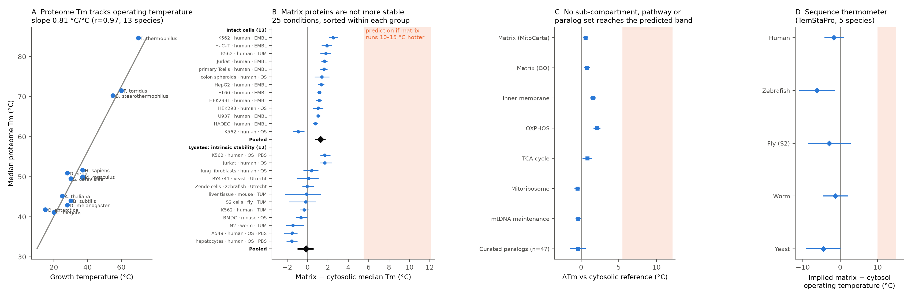

# Are mitochondria really 50 °C? A protein-stability test

In 2018 researchers reported that the inside of mitochondria (the matrix) runs near 50 °C, 10–15 °C hotter than the rest of the cell. Across life, proteins are tuned to the temperature they work at: species that live hotter have proteins that withstand more heat. So if the matrix were persistently that hot, its proteins should withstand roughly 5–12 °C more heat than their neighbours outside mitochondria.

Reanalysing public thermal-stability data (the Meltome Atlas: 6 species, 4 labs, 25 conditions), they don't:

| Test | Matrix − rest of cell | Expected if matrix is +10–15 °C |
|---|---|---|
| Broken-open cells (intrinsic stability) | −0.17 °C [−1.00, +0.58] | +5.5 to +12 °C |
| Intact cells | +1.26 °C [+0.72, +1.77] | +5.5 to +12 °C |
| 47 same-family protein pairs (one in mitochondria, one outside) | −0.45 °C [−1.51, +0.60] | +5.5 to +12 °C |
| Sequence-based stability predictor, 5 species | matrix reads cooler in 5 of 5 | hotter |

A hot matrix is still possible, but only with extra assumptions, e.g. an unmeasured protection worth ~5–12 °C that vanishes when cells are broken open. One alternative is that the rest of the cell gets just as hot, so every protein had to adapt. That would need the rest of the cell near ~47–51 °C, whereas the few published measurements show it warming by 1–2 °C; brief or local spikes have not been ruled out. A single experiment (thermal profiling of intact cells with respiration on vs off) would decide.

This is a computational reanalysis of public data, not a new lab measurement. It was carried out with AI assistance (Anthropic's Claude) and independently reviewed by OpenAI Codex.

- **Executive summary (4 pages):** [HTML](https://paraschopra.github.io/hot-mitochondria/outreach/executive_summary.html) · [PDF](outreach/executive_summary.pdf)
- **Full technical report:** [REPORT.md](REPORT.md) · [PDF](outreach/technical_report.pdf)
- **Proposed experiment:** [protocol draft (PDF)](outreach/protocol_draft.pdf)
- **58-second explainer video:** [video/hot_mitochondria.mp4](video/hot_mitochondria.mp4) (captions in [video/captions.srt](video/captions.srt))

## Layout

| Path | Contents |
|---|---|
| `scripts/` | Python pipeline, numbered in run order (`03_biomart.py` was abandoned: BioMart returned HTTP 405) |
| `results/` | Every intermediate and final number quoted in the report |
| `figures/` | Main figure (wide and 2×2 versions) |
| `outreach/` | Executive summary, technical report and protocol draft (HTML + PDF) |
| `video/` | Explainer video and captions; rebuilt by `scripts/20_score.py` (original synthesised score) and `scripts/21_video.py` |

Key scripts: main estimate `16_revised.py`; per-condition intervals and figure `18_conditions_ci.py`, `14_figures.py`; inner membrane vs matrix `19_subcompartments.py`; paralogs `17_paralogs_curated.py`; sequence thermometer `13_temstapro.py`, `15_temstapro_paired.py`.

## Inputs (public; not committed because of size)

- Meltome Atlas, Jarzab et al. 2020 *Nat Methods* (supplementary tables) and the FLIP benchmark copy of the melting curves
- MitoCarta3.0 (Broad Institute), human
- UniProt REST (annotations, sequences)
- Alliance of Genome Resources orthology
- TemStaPro (Pudžiuvelytė et al. 2024) with ProtT5-XL-U50 embeddings, cloned into `tools/TemStaPro`

Reproduction steps are in [REPORT.md §9](REPORT.md#9-reproduce).

## License

Code: MIT. Text, figures and video: CC BY 4.0. See [LICENSE](LICENSE).
