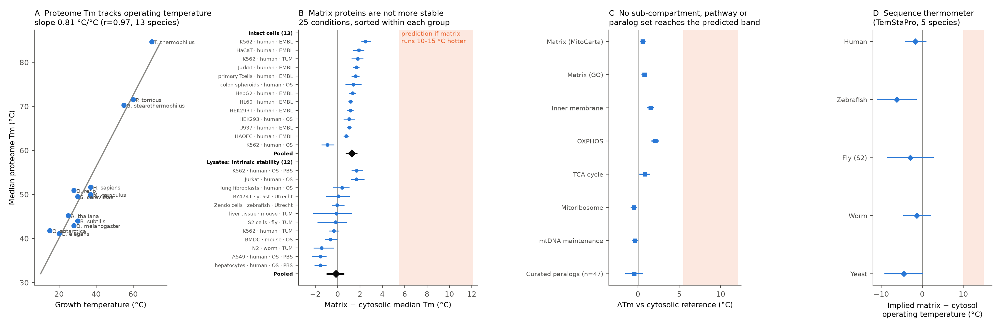

# The mitochondrial matrix proteome carries no signature of a 50 °C environment

**A proteome-scale test of the "hot mitochondria" hypothesis**

*Status: computational result with an independent adversarial review folded in; wet-lab rungs proposed below.
Date: 2026-10-22.*

---

## 1. One-paragraph summary

In 2018, Chrétien et al. reported that the mitochondrial matrix of human cells runs near 50 °C, more than 10 °C above the cytosol (*PLoS Biol* 16:e2003992). Terzioglu et al. later extended this to "up to 15 °C" above ambient in four mammalian lines and one insect line (Drosophila S2), held as a homeostatic steady state (*eLife* 2023).

The claim is disputed on heat-transfer grounds (Baffou 2014; Macherel 2021; Fahimi & Matta 2022; Treberg 2026), though a 2026 study reports that intracellular heat relaxes non-diffusively over seconds, which weakens the conduction-based objection (Takarada et al. 2026, *Nat Commun* 17:4215). It has never been tested against the one thing that should record a persistently hotter environment: **the thermal stability of the proteins that live in it.** Across the tree of life, proteome melting temperature (Tm) tracks the temperature at which proteins operate, at 0.81 °C of Tm per °C of growth temperature (13 species).

We used the Meltome Atlas (about 359,000 per-protein melting points in 77 datasets; analyzed subset: 25 conditions, 6 eukaryotic species, 4 independent labs) to ask whether matrix proteins are more heat-stable than cytosolic proteins of the same cell. **They are not.**
- **Lysates** (intrinsic, sequence-encoded stability): matrix − cytosol = **−0.17 °C** [95% CI −1.00, +0.58].
- **Intact cells**: **+1.26 °C** [+0.72, +1.77].
- **Predicted** if the matrix were 10–15 °C hotter: **+5.5 to +12 °C**.

Two further lines agree:
- **Same-family paralog pairs** (mitochondrial vs cytosolic copy): −0.45 °C [−1.51, +0.60], n = 47.
- **A protein language-model "thermometer"** trained only on prokaryotic growth temperatures, independent of the melting assay: matrix proteins read *cooler* than cytosolic ones in 5/5 species (human −1.7 °C [−4.2, +1.0]).

**Conclusion:** if the matrix really is 10–15 °C hotter, its proteins have not adapted to it, intrinsically or by sequence. The hypothesis then needs an extra assumption: a ~5–12 °C, matrix-specific, non-intrinsic stabilization that disappears on lysis. That stabilization has never been observed, and it is directly testable (Section 6).



*Figure 1.*
- **A.** Median proteome Tm vs growth temperature across 13 species.
- **B.** Matrix − cytosolic median Tm in each of the 25 lab × cell × state × buffer conditions (gene-bootstrap 95% CIs; `scripts/18_conditions_ci.py`), grouped into intact cells and lysates and sorted by value within each group; black diamonds are the pooled two-level-bootstrap estimates. Orange: the band predicted for a matrix 10–15 °C hotter (slope 0.55–0.81).
- **C.** Pooled estimates by definition, sub-compartment, pathway, and for curated paralog pairs.
- **D.** Sequence-thermometer readout of matrix − cytosol operating temperature in five species.

---

## 2. Why this is new and why it matters

- **The open question.** The "hot mitochondria" claim would rewrite the kinetics and thermodynamics of mitochondrial enzymes, drug binding and ROS chemistry. Every published test so far either re-examines the fluorescent probes or argues from heat-diffusion physics. Both sides agree on the measurements and disagree on what the probes report.
- **What this test adds.** It is probe-independent and physics-independent: a biological thermometer integrated over evolutionary time.
- **Literature check, Oct 2026.** Searches covered Google Scholar, PubMed, Europe PMC, bioRxiv and arXiv, with multiple phrasings ("hot mitochondria" × melting / thermal proteome profiling / Meltome / thermostability / paralog / endotherm). The closest prior work:
  - **Jarzab et al. 2020**, the source of the Meltome data. It notes in passing that respiratory-chain proteins are "very stable" and that mitochondria respire at 46 °C. It makes no compartment comparison and does not relate the data to hot mitochondria.
  - **Treberg et al. 2026**, *Acta Physiol*. It argues *qualitatively* that ≥48 °C would cause denaturation, and cites Meltome as showing mitochondrial proteins are *more* stable, which our analysis does not support.
  - **Wilkening et al. 2018**, *JBC*. Heat-induced aggregation of isolated mitochondria.
  - **Moreno-Loshuertos et al. 2023**, *Mitochondrion*. Respiratory complexes degrade above 43 °C.
  - **Lepock et al. 1993**, *JCB*. By calorimetry, isolated mitochondria begin denaturing near 40 °C.

  - **Jacobs et al. 2024**, *FEBS J* 291:5327 (proponents), Supplementary Fig. S1. **This is the closest prior work.** They crossed intact-cell TPP data (K562, Jurkat) with proximity-labelling localisations and found mitochondrial sub-compartments at median Tm 51–54 °C vs about 49 °C for the whole proteome (matrix about 51, cytosol about 49). They interpreted this ~2 °C gradient as *support* for hot mitochondria. They did not derive an expected offset, separate lysate from intact cells, use paralogs or sequence, or replicate across species. Our intact-cell estimate (+1.26 °C) agrees with their observation. Our contribution is to show that this magnitude is roughly 5–10× too small for a 10–15 °C hotter matrix, that the intrinsic (lysate) gap is about 0, and that paralog and sequence evidence concur.
  - **Thomas et al. 2022**, *BBA Proteins*. In *C. elegans*, cytosolic MDH-1 is more thermostable than mitochondrial MDH-2. This is a single pair, but consistent with our result.

  - **Rivera-Mejías et al. 2024**, bioRxiv 10.1101/2024.02.27.582308 (Savitski lab, unpublished). TPP of isolated mitochondria. Antimycin A (25 °C, no added substrates) destabilised 299 of 893 proteins, mostly in the matrix, attributed to loss of membrane potential. No cytosolic comparator, no intact cells, no mention of temperature. Relevant to the proposed experiment: loss of membrane potential pushes matrix Tm the *opposite* way to the hot-matrix prediction.
  - **Cheng et al. 2025**, *eLife* 13:RP102852. Rotenone, antimycin, oligomycin and CCCP in 143B cells, but heating was done on lysates, so a hot matrix could not register. The preprint cited the ~50 °C claim as motivation; the sentence was removed after review.
  - **Misic et al. 2026**, bioRxiv 10.64898/2026.10.13.758515 (Larsson/Savitski). Intact-cell TPP in respirasome-deficient fibroblasts; respiration stays on. "No coordinated changes in thermal stability across the mitochondrial proteome, irrespective of submitochondrial localization."
  - **Fahimi, Lynch & Matta 2026**, *BioEssays* 48:e70159. Theory: picosecond heat spikes from ion re-hydration at the inner membrane, time-averaged by slow probes into an apparent hot signal. Cites the Meltome in one sentence; no analysis, no protein-stability test.
  - **Takarada et al. 2026**, *Nat Commun* 17:4215 (Okabe lab). Non-diffusive, seconds-scale heat relaxation in cells; mitochondria measured at +1.29 °C above surroundings. No protein-stability content.

  Apart from the Jacobs supplementary comparison, no study compares matrix and cytosolic protein stability quantitatively, calibrates the comparison against thermal adaptation, uses paralogs or orthologs, or reads matrix temperature from sequence.

---

## 3. Data and methods (all public; scripts in `scripts/`)

| Item | Source |
|---|---|
| Melting points, 77 datasets | Meltome Atlas, Jarzab et al. 2020 *Nat Methods*, Supplementary Table S2 (per-dataset Tm) and Table S1 (cells/lysate, lysis, lab, range) |
| Melting curves | FLIP benchmark copy of the Meltome (`full_dataset.json`) |
| Mitochondrial annotation | MitoCarta3.0 (human; sub-compartment, pathway) |
| Orthology | Alliance of Genome Resources combined orthology. Strict 1:1 required for non-human species in the revised analysis |
| GO / localization / sequences | UniProt REST (ID mapping; reviewed human proteome) |
| Sequence thermometer | TemStaPro (ProtT5-XL-U50 mean embeddings + MLPs trained on prokaryotic growth temperature), run locally on Apple MPS |

**Definitions**
- **Matrix:** MitoCarta3.0 "Matrix". In non-human species, propagated through strict 1:1 human orthologs.
- **Cytosolic reference:** not in MitoCarta, GO cytosol/cytoplasm/nucleus, and excluding secretory and organellar terms.

**Main estimator**
1. For each dataset, take the median Tm of matrix proteins minus the median Tm of cytosolic proteins.
2. Average replicate datasets within lab × cell type × cells/lysate × lysis buffer, giving 25 conditions.
3. Average conditions within each stratum.
4. Compute uncertainty with a **two-level bootstrap**. Genes are resampled jointly across every dataset and species (Poisson weights), which captures shared proteins. Conditions are then resampled.

**Code**

| Script | Analysis |
|---|---|
| `16_revised.py` | Main estimate |
| `17_paralogs_curated.py` | Paralog pairs |
| `15_temstapro_paired.py` | Sequence thermometer |
| `10_ortholog_calibration.py` | Ortholog calibration |
| `11_curves_at_T.py` | Soluble fraction at fixed temperatures |
| `07_main.py`–`09_robustness.py` | First-pass analyses, superseded where noted |

---

## 4. Results

### 4.1 Calibration: protein Tm records operating temperature
- **Across all 13 species** (archaea to human, lysate, same protocol): median proteome Tm = 0.81 × growth temperature + c (r = 0.97). Species-bootstrap 95% CI for the slope: 0.48–0.93.
- **Eukaryotes only:** slope 0.55 [0.23, 0.87].
- **Ortholog-paired** (the same protein families, human vs worm/fly/fish/yeast): slope about 0.55–0.63.
- **Environment-swap control** (Jarzab Fig. 3C): *Thermus* proteins expressed inside *E. coli* keep their native Tm (median 88.1 vs 85.8 °C, n = 70). Tm is therefore primarily sequence-intrinsic; the surrounding cellular environment moves it only a little.

### 4.2 Matrix proteins are not more stable than cytosolic proteins

| Stratum | k conditions | Matrix − cytosol ΔTm | 95% CI (two-level bootstrap) |
|---|---|---|---|
| Lysates (intrinsic stability) | 12 | **−0.17 °C** | −1.00, +0.58 |
| Intact cells | 13 | **+1.26 °C** | +0.72, +1.77 |
| All | 25 | +0.57 °C | +0.02, +1.10 |
| Non-mammals (worm, fly S2, zebrafish, yeast) | 4 | −0.41 °C | −1.33, +0.34 |
| *Predicted for a +10–15 °C matrix* | | *+5.5 to +12 °C* | |

No single condition out of 25 exceeds +2.5 °C. In *Drosophila* S2 cells, the very line in which hot mitochondria were claimed (Terzioglu 2023), matrix proteins melt 0.2 °C *lower* than cytosolic ones.

**Required-slope test.** Using lysates, a +10 °C matrix is compatible with the data only if the Tm–temperature coupling were below 0.058 °C per °C. Under the species bootstrap, P(slope < 0.058) is 0/4000 for all species and 0.006 for eukaryotes only. Using intact cells, the threshold is 0.177, with P = 0.000 and 0.015.

**Robustness.** Each line pools across 24–25 conditions.

| Variant | Matrix − cytosol ΔTm | 95% CI |
|---|---|---|
| GO-defined matrix | +0.78 °C | +0.42, +1.15 |
| Inner membrane | +1.53 °C | |
| OXPHOS (closest to the putative heat source) | +2.11 °C | +1.66, +2.56 |
| Mitochondrial ribosome | **−0.50 °C** | |
| mtDNA maintenance machinery (nucleoids sit on the inner membrane, at the heat source) | **−0.38 °C** | |
| Length-adjusted | unchanged | |
| Non-melters treated as censored (most stable) | P(matrix > cytosol) = 0.53 | 0.48, 0.59 |

**Inner membrane vs matrix, split by lysate and intact cells** (`scripts/19_subcompartments.py`; same estimator and two-level bootstrap as the headline). If heat were confined to the inner membrane, proteins embedded in it should carry the strongest adaptation. They do not:

| Set (genes) | Lysates (12) | Intact cells (13) |
|---|---|---|
| Matrix, all (505) | −0.17 [−1.01, +0.56] | +1.26 [+0.67, +1.71] |
| Matrix, soluble non-OXPHOS (493) | −0.25 [−0.98, +0.48] | +1.23 [+0.74, +1.72] |
| Inner membrane, all (307) | +0.18 [−1.20, +1.68] | +2.20 [+1.44, +2.83] |
| Inner membrane, non-OXPHOS (183) | −0.36 [−2.09, +1.30] | +1.87 [+1.15, +2.62] |
| OXPHOS subunits (147) | +1.08 [−0.62, +2.52] | +2.77 [+1.89, +3.89] |

Every lysate upper bound is below 2.6 °C, against a predicted +5.5 to +12 °C. The larger intact-cell values for membrane proteins are consistent with stabilisation by membrane embedding and complex assembly, which lysis removes.

Matrix proteins are also *less* often non-melters than cytosolic proteins. Reading even OXPHOS's upper bound through the most permissive (eukaryote) slope gives at most about 4.7 °C.

### 4.3 Paralogs: same family, different compartment
- **Set:** 47 curated same-family pairs (e.g. IDH2/IDH1, GOT2/GOT1, HSPA9/HSPA8, TRAP1/HSP90AA1, TUFM/EEF1A1, 16 mitochondrial/cytosolic aminoacyl-tRNA-synthetase pairs).
- **Checks:** localization verified (mitochondrial copy in MitoCarta, cytosolic copy not), and each protein used once.
- **Result:** mean ΔTm(mitochondrial − cytosolic) = **−0.45 °C** [−1.51, +0.60]; 47% of mitochondrial copies are more stable.
- **Split by sample type:** lysates −0.80 °C, intact cells −0.06 °C.

### 4.4 Sequence thermometer (independent of the melting assay)
- **Model:** TemStaPro, never trained on eukaryotes or on Meltome data.
- **Positive control passes:** human proteins score "hotter" than their cytosolic orthologs in all four colder species (worm, fly, fish, yeast). Calibration: 0.049 score units per °C.
- **Result:** within every species, matrix proteins score *lower* than cytosolic proteins.

| Species | Implied matrix − cytosol operating temperature | 95% CI |
|---|---|---|
| Human | −1.7 °C | −4.2, +1.0 |
| Worm | −1.3 °C | |
| Fly | −2.9 °C | |
| Yeast | −4.5 °C | |
| Zebrafish | −6.2 °C | |
| *Predicted* | *+10 to +15 °C* | |

### 4.5 How fragile would a 50 °C matrix be?
In intact human cells (7 lines, EMBL), after just 3 minutes:
- **At 47 °C:** 6% of matrix proteins are more than 50% aggregated.
- **At 50 °C:** 27% are.

Caveat: under the hypothesis itself, the bath temperature is not the matrix temperature. This is supporting context, not a primary test.

### 4.6 What did *not* work or was dropped
- **Intact-cell vs lysate comparison in matched K562 runs.** The sign flipped with lysis buffer (NP40 +2.1 °C, PBS −2.5 °C), so it is dominated by protocol and is not used as evidence.
- **Endotherm-vs-ectotherm comparison.** Matrix orthologs gain about 0.8 °C extra going from ectotherms to human, which equals the mouse-vs-human excess. This is uninformative about a *universal* hot matrix, because the proponents claim the effect in flies too. It bears only on an endotherm-specific version.

---

## 5. Verification ladder

Each rung is an independent way the result could have failed.

| # | Rung | Status | Outcome |
|---|---|---|---|
| 1 | Effect seen in one dataset | done | yes |
| 2 | Replicates across **4 independent labs**, 25 conditions, 6 species | done | consistent; no condition above +2.5 °C |
| 3 | Two independent mitochondrial definitions (MitoCarta, GO) | done | +0.6 / +0.8 °C |
| 4 | Lysate (intrinsic) vs intact cells (in situ) | done | −0.2 / +1.3 °C |
| 5 | Censoring-aware ranks with non-melters included | done | P(sup) = 0.53 |
| 6 | Uncertainty with gene-cluster + condition two-level bootstrap | done | CIs exclude +5 °C by a wide margin |
| 7 | Calibration uncertainty propagated (species bootstrap; required-slope test) | done | P(slope small enough) ≤ 0.015 |
| 8 | Within-family control: 47 curated paralog pairs | done | −0.45 °C |
| 9 | Orthogonal method: sequence thermometer, prokaryote-trained, with positive control | done | 0/5 species positive |
| 10 | Environment-swap check that Tm is intrinsic (*Thermus* proteins in *E. coli*) | done | Tm retained |
| 11 | Independent adversarial review by a second AI model (Codex); critiques folded in | done | see §7 |
| 12 | **Wet lab A:** intact-cell TPP ± respiration block (antimycin + oligomycin, or KCN) vs uncoupler, in HEK293 and S2 cells | proposed | hot mito predicts matrix-specific ΔTm of about +5–15 °C when respiration stops; our model predicts < 1 °C |
| 13 | **Wet lab B:** TPP of isolated mitochondria energized (succinate + ADP) vs de-energized, same temperatures | proposed | same contrast, without cytosol |
| 14 | **Wet lab C:** DSF/nanoDSF of purified matrix vs cytosolic paralogs (IDH2/IDH1, GOT2/GOT1, SHMT2/SHMT1) in matrix-mimetic buffer (pH 7.9–8.0, 0.5 mM free Mg²⁺, crowders) | proposed | tests the "matrix milieu protects" escape route directly |
| 15 | **Comparative:** TPP of bird (41 °C) and tuna/lamnid red-muscle cells; heterotherms | proposed | Tm should track tissue temperature for cytosolic proteins (positive control) while matrix offsets stay ≈ 0 |

Rung 12 is the decisive, cheap experiment. If matrix proteins sit 10 °C hotter than the bath during heating, stopping respiration must raise their apparent in-cell Tm by about 10 °C relative to cytosolic proteins. That is a 1–2 week standard TPP experiment.

---

## 6. What the result does and does not show

**It shows that the matrix proteome is not intrinsically adapted to a hotter environment.** Its sequence-encoded stability, in lysates, by paralog, and by sequence model, matches the cytosol's to within about 1 °C, despite protein Tm tracking operating temperature everywhere else in biology.

**It does not, by itself, measure matrix temperature.** For the hot-mitochondria hypothesis to survive, one of these must be true:
- **(a) Extrinsic protection.** Stability that is matrix-specific, worth 5–12 °C of Tm, and lost on lysis, coming from chaperones, ligands, crowding or pH. No such protection has been measured, and intact-cell data show only about +1.3 °C.
- **(b) A non-adaptive matrix.** Matrix proteins run continuously within a few degrees of their melting point, uniquely among compartments.
- **(c) A limited heat claim.** The "temperature" the probes report is transient, nanoscale or membrane-local rather than a steady bulk-matrix temperature. The original reports claim the opposite (a homeostatic steady state), but Fahimi, Lynch & Matta (2026) now propose exactly this reading: picosecond heat spikes at the inner membrane, averaged by slow probes. Our data cannot test such spikes, which would leave no imprint on protein stability; they rule out the steady version. Even inner-membrane proteins show no intrinsic adaptation (section 4.2).

Each of these is a falsifiable and specific prediction (rungs 12–14). That conditional framing is the publishable claim.

---

## 7. Independent review (Codex) and how it changed the analysis

An adversarial review by a second AI model (OpenAI Codex) of the first-pass code and claims raised these points. Each was confirmed and fixed, or adopted as a stated limitation:

| Critique | Action |
|---|---|
| Gene symbols overwritten for accession-style IDs | Fixed; only applied when UniProt has no gene name |
| Orthology propagation not 1:1 | Strict 1:1 (both directions) required in revised analysis |
| Replicates merged across labs/protocols | Condition now keyed by lab × cell × state × lysis; per-dataset estimates first |
| CIs ignore shared proteins | Two-level (gene-cluster + condition) bootstrap |
| Invalid paralog pairs (e.g. ACADM–ACOX1, SOD2–SOD1, GLS–GLS2) | Curated 52-pair list, localization-checked (47 pass), each protein once |
| Wrong Mann–Whitney SE | Hanley–McNeil SE |
| Fly growth temperature inconsistent (25 vs 28 °C) | Meltome value 28 °C used throughout |
| Regression-to-mean in Tm-window subanalysis | Dropped |
| **Calibration slope across species may not transfer to compartments; slope CI is wide** | Kept as the central stated assumption. Slope uncertainty is propagated (§4.2). Headline reframed from "matrix ≤ 1–2 °C hotter" to "no intrinsic adaptation; survival requires extrinsic protection" (§6) |
| **Intact-cell Tm is in bath-temperature coordinates** | Primary inference now rests on lysates, paralogs and sequence; intact-cell data are used only as a bound on in-situ protection |
| **Comparative test assumed a human-only gradient** | Replaced with within-species tests in all species; endotherm comparison demoted (§4.6) |

---

## 8. Limitations
- **Tm here is a thermal-solubility (aggregation) midpoint after 3 minutes of heating, not an equilibrium unfolding temperature.** That matches how Tm was calibrated against growth temperature, but kinetics matter.
- **Mitochondrial labels come from human MitoCarta.** For non-human species they are propagated by orthology; even with 1:1 filtering, localization may differ.
- **The proteomics samples only measurable proteins.** Very low-abundance matrix proteins are under-represented.
- **The sequence thermometer is trained on prokaryotes.** Its absolute °C scale is approximate, and only its sign and rough magnitude are used.
- **Data constraints:**
  - The fly comparison uses S2 *lysate*, not the intact-cell assay.
  - Zebrafish data come from a 40–67 °C range, so low Tm values are truncated.
  - No bird or heterotherm meltome exists yet.

## 9. Reproduce
Run from the repository root. Inputs are public and are not committed because of size (see README); `scripts/13_temstapro.py` also needs a local clone of [TemStaPro](https://github.com/ievapudz/TemStaPro) in `tools/TemStaPro`.

```
python scripts/01_flatten_meltome.py   # FLIP copy (curves)
python scripts/02b_uniprot_idmap.py && python scripts/02c_fill_missing.py
PYTHONPATH=./pylib python scripts/04_supp_tables.py
python scripts/05_within_species.py && python scripts/06_build_labels.py
python scripts/16_revised.py           # main result
python scripts/17_paralogs_curated.py  # paralogs
HF_HOME=$PWD/hf_cache python scripts/13_temstapro.py && python scripts/15_temstapro_paired.py
python scripts/18_conditions_ci.py
python scripts/19_subcompartments.py  # inner membrane vs matrix, lysate vs cells
python scripts/14_figures.py
```

Results are written to `results/` and figures to `figures/`.
